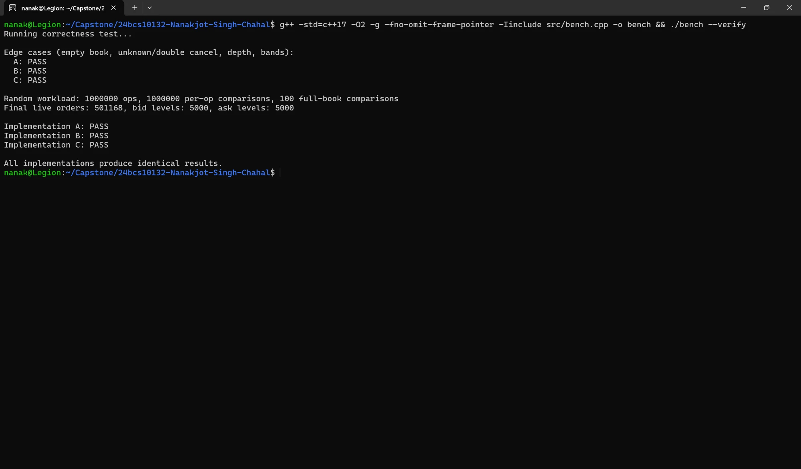
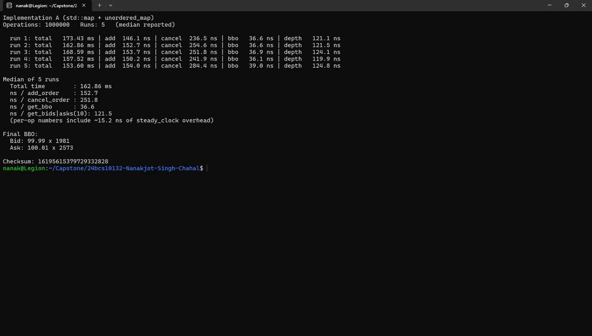
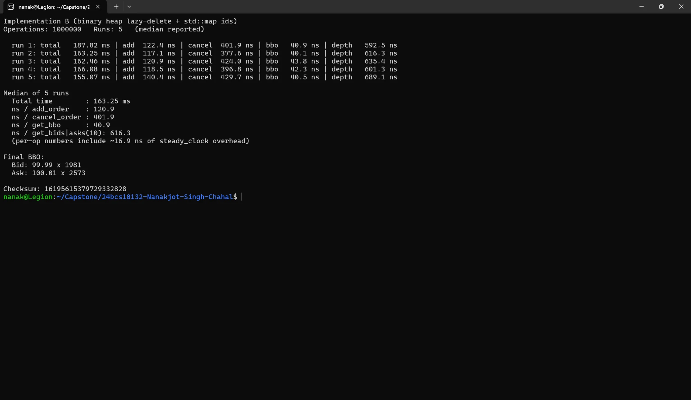
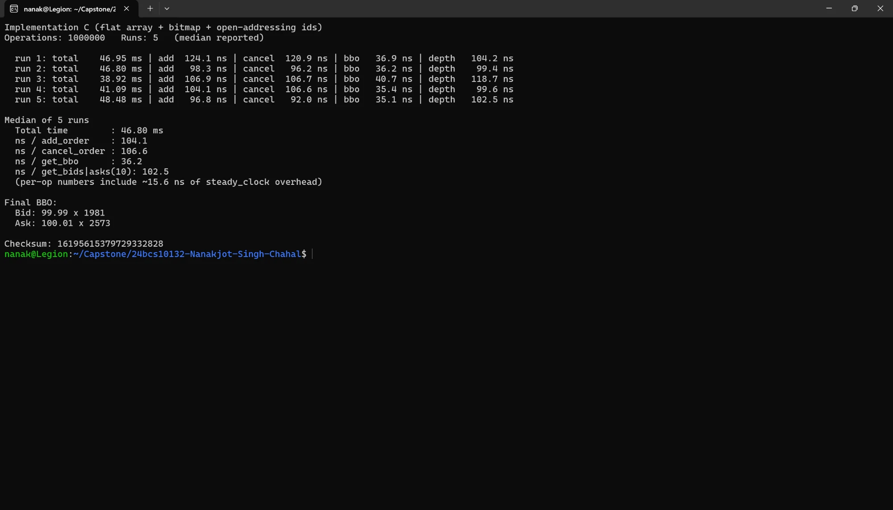
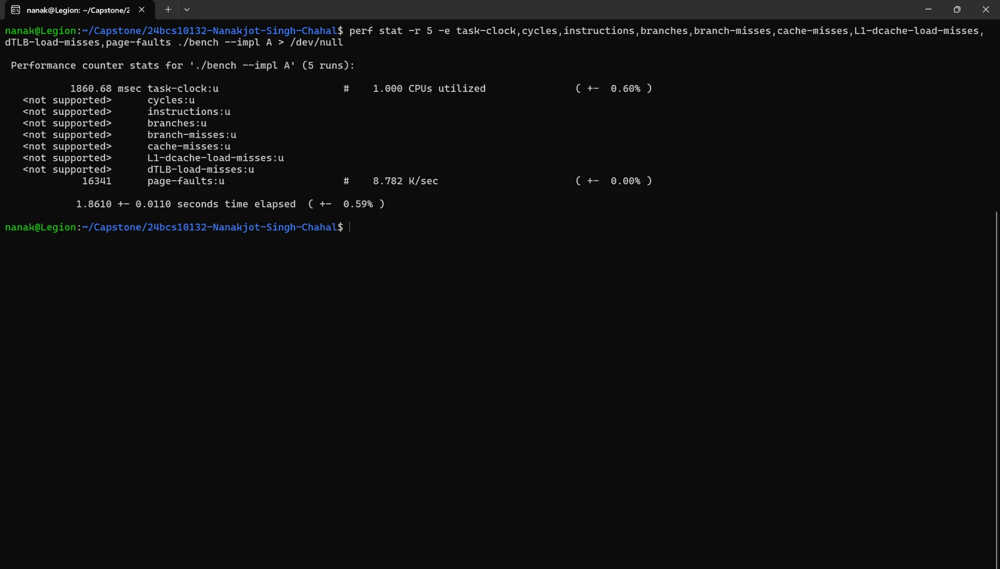
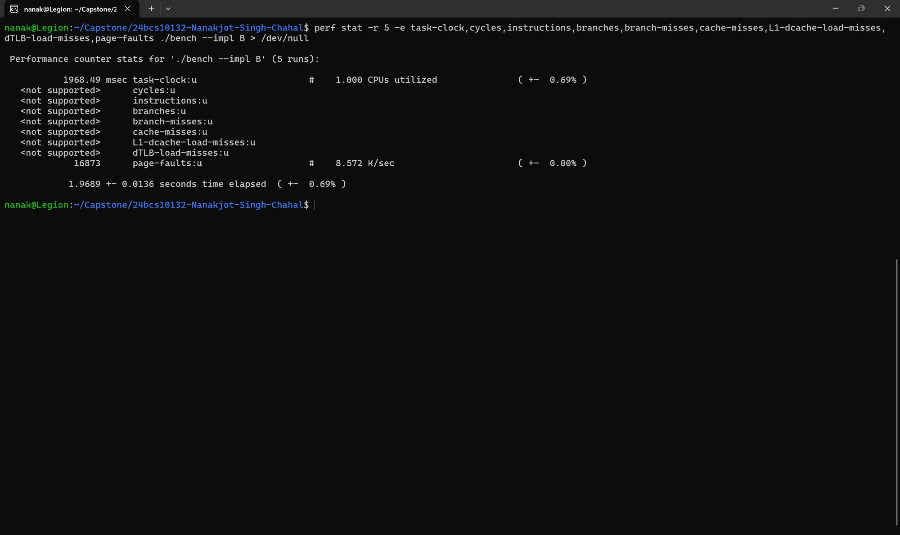
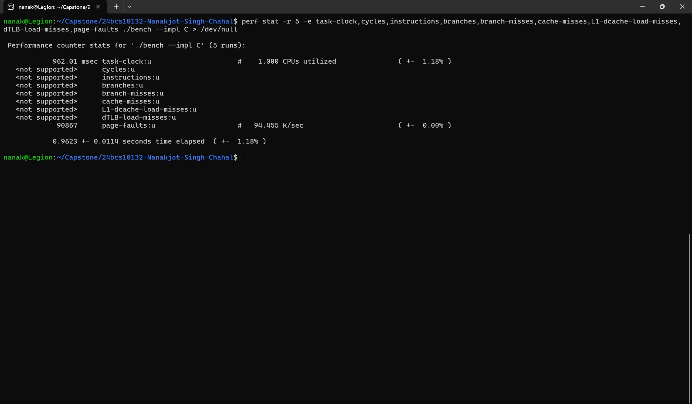
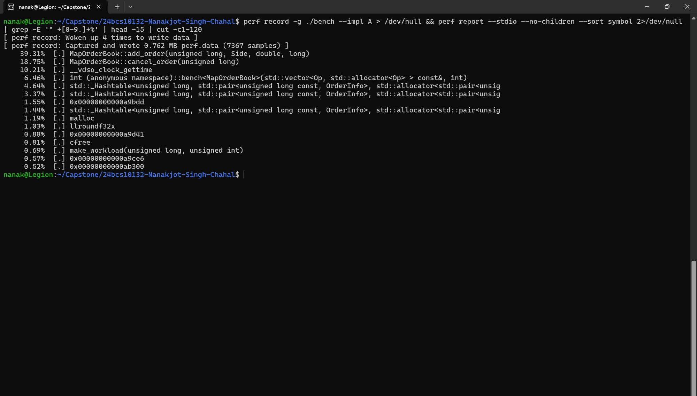
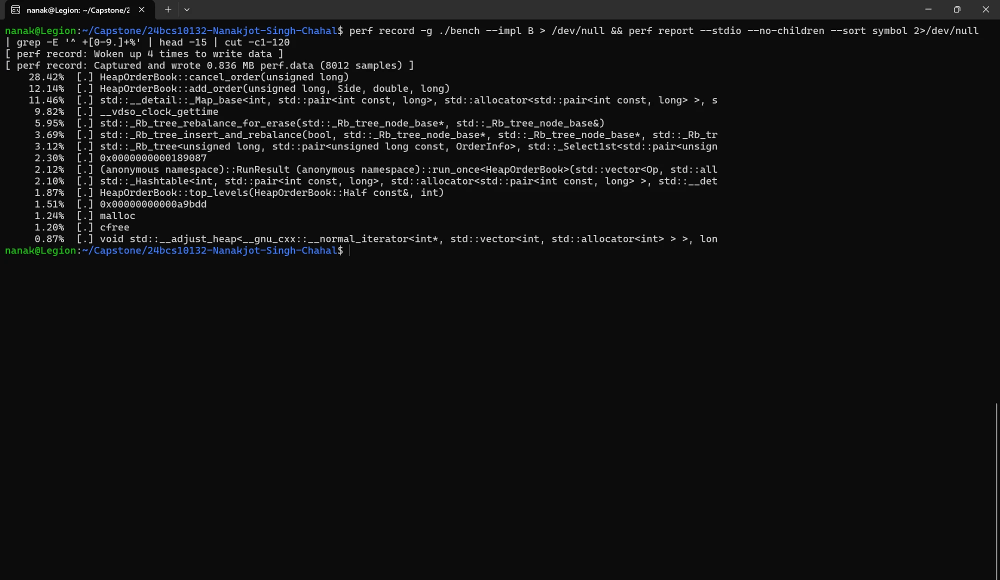
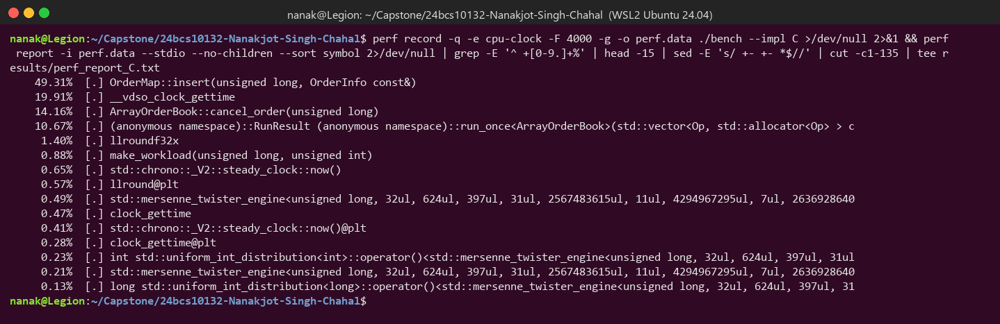

# Capstone: Low-Latency Order Book

| | |
|---|---|
| Name | Nanakjot Singh Chahal |
| Roll number | 24BCS10132 |
| SST email | nanakjot.24bcs10132@sst.scaler.com |

A resting order book for one instrument, implemented three times with different data
structures. One benchmark binary runs any of them on the same workload, and a `--verify`
mode checks that all three return identical results. The full analysis is in
[REPORT.md](REPORT.md). Raw outputs are in [results/](results/).

## Layout

```
include/common.hpp        Side, Level, BBO, OrderInfo, price <-> tick helpers
include/book_a_map.hpp    Implementation A: std::map levels + std::unordered_map ids
include/book_b_heap.hpp   Implementation B: binary heap (lazy delete) + std::map ids
include/book_c_array.hpp  Implementation C: flat array + bitmap + own open-addressing hash
include/workload.hpp      deterministic workload generator (std::mt19937, seed 42)
src/bench.cpp             benchmark (--impl A|B|C) and correctness test (--verify)
scripts/run_perf.sh       re-collects every result file on a Linux machine
results/                  outputs used in the report
```

## Build

You only need g++ (C++17) and the standard library.

```bash
g++ -std=c++17 -O2 -g -fno-omit-frame-pointer -Iinclude src/bench.cpp -o bench
```

or `make`. The `-g -fno-omit-frame-pointer` flags only make `perf record -g` output
readable. They don't change the `-O2` code generation.

## Run

```bash
./bench --verify            # correctness test, all three implementations
./bench --impl A            # benchmark A (5 runs, median reported)
./bench --impl B
./bench --impl C
./bench --impl C --runs 1   # optional: a single run
./bench --impl C --ops 200000
```

`perf` (from the project folder):

```bash
perf stat -r 5 -e task-clock,cycles,instructions,branches,branch-misses,cache-misses,L1-dcache-load-misses,dTLB-load-misses,page-faults ./bench --impl A
perf record -g ./bench --impl A && perf report
```

## Interface changes

The required API is kept exactly: the same `Side`, `Level`, `BBO` and five methods with
`double` prices. The only additions:

* Internally every book stores prices as **integer ticks** (`tick = llround(price * 100)`,
  so 100.01 → 10001). The conversion happens once at the API boundary.
* Invalid input is **ignored** by `add_order` (it stays `void`). This covers qty ≤ 0, a
  price off the 0.01 grid, a price outside the side's band (bids 50.00–99.99, asks
  100.01–150.00), and a duplicate id. A later `cancel_order` of such an id returns `false`.
* Each book class has a `static constexpr const char* kName` for printing.
* There is no virtual base class. The benchmark is a template (`bench<Book>()`), so all
  three use the same code path with no virtual-call overhead.

## Data-structure choices

| | A: tree | B: heap | C: own design |
|---|---|---|---|
| Order storage (id → order) | `std::unordered_map<id, OrderInfo>` (chained hash, one node per order) | `std::map<id, OrderInfo>` (red-black tree) | `OrderMap`: own open-addressing hash, linear probing, Fibonacci hashing, backward-shift delete, one flat array |
| Price-level storage | `std::map<tick, qty>` per side (`greater<>` for bids) | `std::unordered_map<tick, qty>` per side, plus a binary heap of ticks | `long qty[10001]` indexed by `tick - 5000`, plus a 157-word occupancy bitmap |
| Finding best bid/ask | `begin()` of the map | top of the heap. Empty levels stay in the heap ("lazy deletion") and are popped only when they reach the top, so `top()` is always live | cached `best_bid_`/`best_ask_` index. When the best level empties, find the next set bit with `clz`/`ctz` |
| Cancel lookup | hash lookup | tree lookup | probe in flat array |

### Complexity

L = non-empty price levels on one side (≤ 5000), N = live orders, d = depth requested,
W = bitmap words (157).

| Operation | A | B | C |
|---|---|---|---|
| add_order | O(1) avg + O(log L) | O(log N) + O(1) avg (+ O(log L) heap push if the level is new) | O(1) avg |
| cancel_order | O(1) avg + O(log L) | O(log N) + O(1) avg (+ amortised O(log L) stale pops) | O(1) avg, worst O(W) bitmap scan when the best level empties |
| get_bbo | O(1) | O(1) | O(1) |
| get_bids / get_asks | O(d) | O(L + d log L) (copies the heap, then pops) | O(d + W) |

## Correctness results

`./bench --verify` first runs the edge cases from the spec on each implementation: empty
book, unknown cancel, double cancel, insufficient depth, quantity aggregation at one price,
best-price repair after a level empties, and invalid prices or quantities. Then it replays
the full 1,000,000-op benchmark workload through A, B and C in lockstep. After **every**
op it compares the BBO and the top-10 bid and ask levels. Every 10,000 ops it compares the
**whole** book (all levels) of all three against a brute-force rebuild from the raw list of
live orders.

```
Running correctness test...

Edge cases (empty book, unknown/double cancel, depth, bands):
  A: PASS
  B: PASS
  C: PASS

Random workload: 1000000 ops, 1000000 per-op comparisons, 100 full-book comparisons
Final live orders: 501168, bid levels: 5000, ask levels: 5000

Implementation A: PASS
Implementation B: PASS
Implementation C: PASS

All implementations produce identical results.
```

The three benchmark runs also print the same checksum (`16195615379729332828`) and final
BBO (`99.99 x 1981 / 100.01 x 2573`).

## Performance results

Machine: Intel Core i9-14900HX, Ubuntu 24.04 under **WSL2**, g++ 13.3, `-O2`. Medians of
5 runs, 1,000,000 ops (see [results/environment.txt](results/environment.txt)).

| Metric | Implementation A | Implementation B | Implementation C |
|---|---|---|---|
| Total time (ms) | 164.71 | 174.61 | **41.89** |
| ns / add | 154.4 | 122.1 | **116.2** |
| ns / cancel | 262.1 | 442.1 | **113.5** |
| ns / BBO | 36.2 | 41.5 | **35.1** |
| ns / get_bids or get_asks(10) | 128.0 | 606.7 | **105.6** |
| IPC | n/a in WSL2 | n/a in WSL2 | n/a in WSL2 |
| Branch misses (%) ¹ | 7.5% (18.9 M) | 1.6% (18.0 M) | 3.1% (2.5 M) |
| L1-dcache-load-misses ¹ | 23.8 M | 35.1 M | **4.9 M** |
| Cache misses (last level) ¹ | 2.43 M | 2.53 M | 3.31 M |
| Page faults (perf stat, per process) | 16,342 | 16,872 | 90,868 |
| task-clock (perf stat -r 5, whole process) | 1924.3 ms | 2043.3 ms | 942.4 ms |
| Instructions ¹ | 1.61 G | 2.80 G | 0.80 G |

Per-op ns include about 16 ns of `steady_clock::now()` overhead (printed by the benchmark).
"Total time" comes from a separate pass with no timers inside the loop.

¹ **perf hardware counters are not available under WSL2.** Hyper-V does not expose the
PMU, so `cycles`, `instructions`, `branches`, `branch-misses`, `cache-misses`,
`L1-dcache-load-misses` and `dTLB-load-misses` all report `<not supported>`, and IPC cannot
be computed. `task-clock`, `page-faults`, `context-switches` and `cpu-migrations` work. To
still compare branch and cache behaviour, those rows come from **Valgrind cachegrind**
(`--cache-sim=yes --branch-sim=yes`, one run of `./bench --impl X --runs 1`). Those numbers
are a simulation of an L1/LL cache and branch predictor, not hardware counts. They cover
the whole process, including workload generation. `scripts/run_perf.sh` re-collects
everything with real counters on a lab Linux machine.

### perf stat: Implementation A

```
 Performance counter stats for './bench --impl A' (5 runs):

           1924.32 msec task-clock:u                     #    0.999 CPUs utilized               ( +-  1.25% )
   <not supported>      cycles:u
   <not supported>      instructions:u
   <not supported>      branches:u
   <not supported>      branch-misses:u
   <not supported>      cache-misses:u
   <not supported>      L1-dcache-load-misses:u
   <not supported>      dTLB-load-misses:u
             16342      page-faults:u                    #    8.492 K/sec                       ( +-  0.00% )

            1.9262 +- 0.0240 seconds time elapsed  ( +-  1.25% )
```

### perf stat: Implementation B

```
 Performance counter stats for './bench --impl B' (5 runs):

           2043.26 msec task-clock:u                     #    0.999 CPUs utilized               ( +-  0.60% )
   <not supported>      cycles:u
   <not supported>      instructions:u
   <not supported>      branches:u
   <not supported>      branch-misses:u
   <not supported>      cache-misses:u
   <not supported>      L1-dcache-load-misses:u
   <not supported>      dTLB-load-misses:u
             16872      page-faults:u                    #    8.257 K/sec                       ( +-  0.00% )

            2.0445 +- 0.0124 seconds time elapsed  ( +-  0.61% )
```

### perf stat: Implementation C

```
 Performance counter stats for './bench --impl C' (5 runs):

            942.41 msec task-clock:u                     #    0.999 CPUs utilized               ( +-  0.63% )
   <not supported>      cycles:u
   <not supported>      instructions:u
   <not supported>      branches:u
   <not supported>      branch-misses:u
   <not supported>      cache-misses:u
   <not supported>      L1-dcache-load-misses:u
   <not supported>      dTLB-load-misses:u
             90868      page-faults:u                    #   96.421 K/sec                       ( +-  0.00% )

           0.94296 +- 0.00589 seconds time elapsed  ( +-  0.62% )
```

`perf record -g` (software `cpu-clock` sampling) hot spots are in
`results/perf_report_{A,B,C}.txt`, and cachegrind summaries are in
`results/cachegrind_{A,B,C}.txt`. They are discussed in [REPORT.md](REPORT.md).

## Screenshots

Real screenshots of my Windows Terminal (WSL2 Ubuntu 24.04) taken while running each
command. They come from a separate run from the one in the results table, so the timings
differ by a few percent. The checksums and final BBO are identical.

| Step | Screenshot |
|---|---|
| Build + correctness test |  |
| Benchmark A |  |
| Benchmark B |  |
| Benchmark C |  |
| perf stat A |  |
| perf stat B |  |
| perf stat C |  |
| perf record/report A |  |
| perf record/report B |  |
| perf record/report C |  |

Cachegrind output is in `results/cachegrind_{A,B,C}.txt`.
